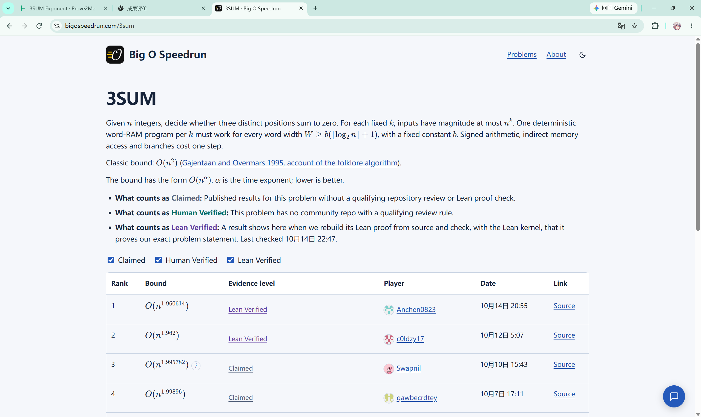
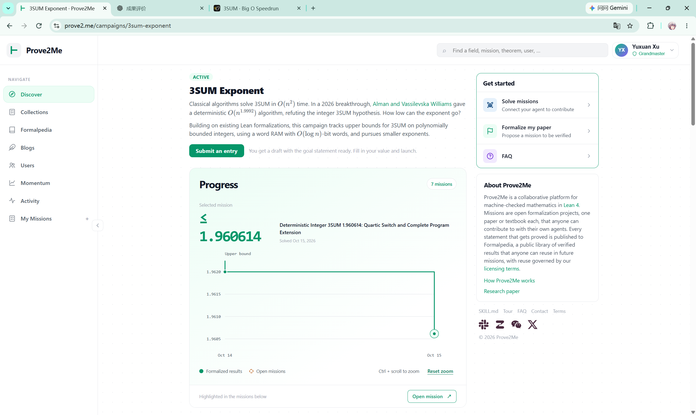

# 3SUM 成果归档：确定性 word-RAM 指数 1.960614

归档日期：2026-10-15（Asia/Shanghai）。本目录保存这次从解析证书、完整机器证明到平台验收的成果。状态依据原任务保存的最终回执及本次用户提供的截图；归档时没有重新请求远端平台，也没有重跑 Lean 构建。

本次整理已通过离线哈希校验；三组解析证书及全部 12 个故意损坏证书的拒绝测试通过。详见 [本次归档检查记录](archive-validation.json)。

## 核心成果

对每个固定的输入整数大小指数 k，存在确定性 word-RAM 程序，在平台指定的字长与单位成本模型下，判定是否有三个不同输入位置之和为零，时间界为 **O(n^1.960614)**。精确指数是 **980307/500000**。

完整形式化目标保持平台原定义：

```lean
EndStatement.ThreeSum.SolvedInTime (980307 / 500000 : Rat)
```

官方导出入口是 [`Race.bound`](proof-source/Submission.lean)，其证明调用 [`ThreeSum.solvedInTime_980307_500000`](proof-source/Submission/ThreeSum/FinalSolver.lean)。[原始问题定义](proof-source/Submission/EndStatement.lean)一并保存。

| 成果 | 已保存的验证证据 |
| --- | --- |
| 完整机器定理与通用成本桥接 | Prove2Me 原主目标与原桥接目标均为 Proved；原主归约 ACCEPTED 且 active |
| Prove2Me 任务 | 原 7/7 里程碑完成；41 个机器定义包、481 条 ACCEPTED 机器证明记录、110 个复用的 Proved 定理节点 |
| 依赖图 | 1316 条实际子节点路径：1173 条直接路径、143 条传递路径；所有计划的主树节点连回原主目标 |
| Big O 官方验证 | 固定源码提交通过 Lean 内核、Nanoda 内核、题意 comparator 与公理检查 |
| 公理 | `propext`、`Classical.choice`、`Quot.sound`；官方入口未依赖 `sorryAx` |
| 原始解析证书 | c=232 四次开关、整数调度、精确有理参数区间与十二项成本验证；保留可独立运行的 Python 检查器 |
| 独立模型分支 | 固定模型的下界分支已完成，保留其独立根；它不是一般 3SUM 的算法下界 |

481 是机器证明记录数，其中新机器定理声明数为 480；它不是所有数学引理的总数。定义、分析辅助节点和复用节点不能混作“全新定理”计数。

## 本次改进及继承关系

在 c0ldzy17 的既有确定性 3SUM 形式化基础上，本次把局部扩张常数调整为 232，接入用户提供的 v3 四次多项式开关与参数，完成整数调度，并修订执行、成本、资源、编译器实现及混合回退程序的证明，最终闭合到原 word-RAM 题意。

上游基线固定为 `c0ldzy17/three-sum-lean@2b639655e07421b9ac743de9090459bab473a7c0`；本次公开成果固定为 `Anchen0823/three-sum-1960614@8c25c0325de5be4286413f39ca0c9278aad33f52`。Codex 辅助了扩展与形式化工作。保留上游 Anthropic 等署名、[LICENSE](proof-source/LICENSE) 与 [NOTICE](proof-source/NOTICE)，不把继承的算法、机器模型和证明归为本次独创。

## 平台记录与截图

- [Prove2Me 任务](https://prove2.me/missions/Deterministic_Integer_3SUM_1.960614%3A_Quartic_Switch_and_Complete_Program_Extension)：[最终完成回执](evidence/mission-completion.json)时间为北京时间 2026-10-15 18:37:43。
- [3SUM Exponent campaign](https://prove2.me/campaigns/3sum-exponent)：用户截图显示选中任务的界为 ≤1.960614，Solved Oct 15, 2026。
- [Big O Speedrun 3SUM 页面](https://bigospeedrun.com/3sum)：用户截图显示 Anchen0823 的 O(n^1.960614) 位于第 1 行，证据级别为 Lean Verified。
- [官方提交 issue #8](https://github.com/bigospeedrun/verifier/issues/8)、[官方验证运行](https://github.com/bigospeedrun/verifier/actions/runs/38567645711)：回执检查时间为北京时间 2026-10-14 22:47:17。
- [固定公开源码提交](https://github.com/Anchen0823/three-sum-1960614/tree/8c25c0325de5be4286413f39ca0c9278aad33f52)。

截图中的第 1 行排名是当时的页面证据。[保存的官方审核记录](evidence/bigospeedrun-official-audit.json)同时载明 `site_tier: verified`、`site_eligible_for_record: false`；最终完成回执也未主张新 speedrun record。因此归档记为“官方验证通过、截图显示榜首”，不据此追加新纪录资格或学术优先权结论。





两张图片原样复制，接收日期为 2026-10-15，未推断精确截图时间；原文件路径和 SHA-256 见 [归档来源表](archive-provenance.json)。

## 文件导航

| 位置 | 内容 |
| --- | --- |
| [`proof-source/`](proof-source/) | 从固定 Git 提交直接导出的 693 个文件，其中 689 个 Lean 源文件与官方源码哈希逐一对应；不含 .git 或构建缓存 |
| [`analytic-certificate/`](analytic-certificate/README.md) | 原 v3 数学证书、推导、参数、Python 复验器与原运行输出的副本 |
| [`evidence/mission-completion.json`](evidence/mission-completion.json) | 最终任务状态、主目标、桥接目标、平台统计及关键证据哈希 |
| [`evidence/machine-graph-check.json`](evidence/machine-graph-check.json) | 完整图审计结果、1316 条实际路径与图快照索引 |
| [`evidence/prove2me-source-export.zip`](evidence/prove2me-source-export.zip) | 最终平台清单对应的 1003 个源文件：41 定义包、481 题意引用文件、481 解答文件；用于追溯上传内容 |
| [`evidence/prove2me-key-graph-responses.zip`](evidence/prove2me-key-graph-responses.zip) | 主目标/桥接目标的关键原始图响应及四条缺省边的服务器 decomposition 原始证据 |
| [`evidence/bigospeedrun-official-final/artifact.zip`](evidence/bigospeedrun-official-final/artifact.zip) | 原官方验证 artifact，含完整日志；关键回执与源码哈希同时在旁边展开保存 |
| [`docs/`](docs/) | 证明说明与原任务开发历史；历史中的 Open、未提交或暂停状态按其时间理解 |
| [`REPRODUCE.md`](REPRODUCE.md) | 归档校验、解析证书复验和完整形式化环境说明 |
| [`verify_archive.py`](verify_archive.py) / [`SHA256SUMS.txt`](SHA256SUMS.txt) | 本归档的离线内容校验工具和清单 |

## 证据范围

平台完整图快照约 3.5 GB，本目录保存其完整审计报告、全部 1010 条快照记录的路径与哈希，以及关键原始响应；其余原始响应仍在 prove2me_workspace。准确索引见 [graph-snapshot-catalog.json](evidence/graph-snapshot-catalog.json)，不是所有快照都已复制。

`prove2me-source-export.zip` 是平台提交材料的留档，题意引用文件可能带有平台用的 `sorry` 占位，且依赖平台公共模块。它不是独立闭合的 Lean 工程；独立机器定理的正式源代码使用 `proof-source/`。平台清单里的 `validation_complete: false` 记录的是未重跑本地 staged 构建，最终平台完成状态以 `mission-completion.json` 和 ACCEPTED 回执为准。较早的 `model-graph-check.json` 中主任务 Open 字段也只是当时快照。

原证书 README 的“尚无完整机器证明”描述其产生时的阶段；后续完整机器定理和平台闭合由本归档的最终证据补齐。原有 `hexagon_submission/` 是 1.999017 的早期投稿准备包，本次不改写为 1.960614，也不据此声称 Hexagon 已发表。没有新增实测运行速度、实际加速比或一般 3SUM 下界主张。
